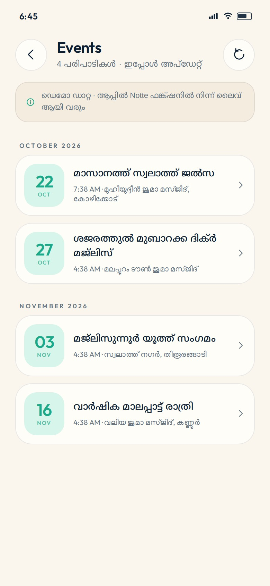
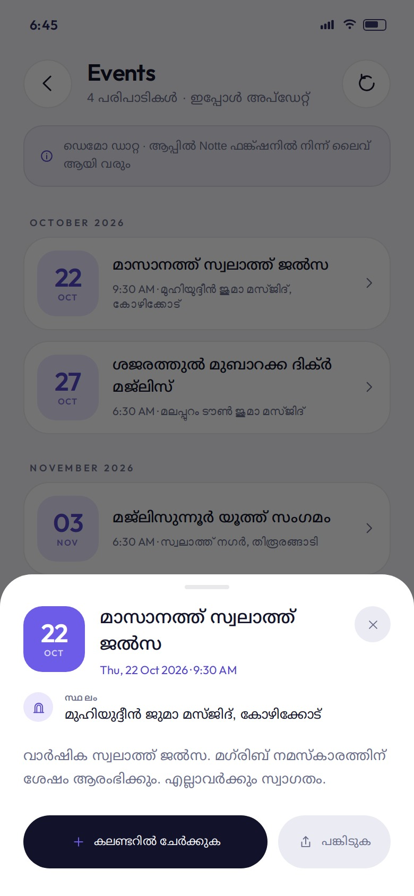
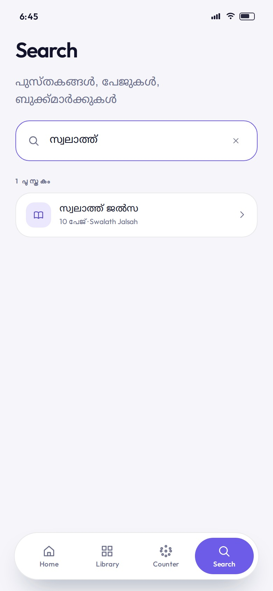
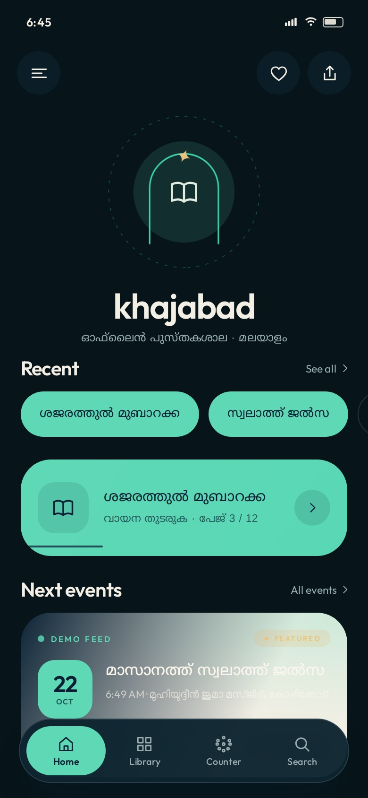

# khajabad · ഖജാബാദ്

A modern, offline PDF reader for Malayalam devotional books — built with **Kotlin + Jetpack Compose** and **no Material theme or Material components**. Cream paper, mint surfaces, deep‑ink typography, and motion that settles like water.

<p align="center">
  
  
  
  
</p>

---

## Install

<a href="https://github.com/kuttappu507/khajabad/releases/download/latest/khajabad.apk"><b>⬇ Download khajabad.apk</b></a> — signed release build (v1.1.1), Android 6.0+, ~16 MB. The books are fully offline; the optional events feed is the only thing that touches the network.

Trouble installing ("App not installed")? See **[docs/INSTALL.md](docs/INSTALL.md)** — it is almost always an old copy signed with a different key, or the CI *zip* being installed instead of the `.apk`.

---

## Screens

<p align="center">
  
  
  
</p>
<p align="center">
  
  
  
</p>
<p align="center">
  
  
  
  
  
</p>

---

## Look at it first

`preview/index.html` is a **fully interactive prototype** of the app (same palette, type, motion and the real book pages). Open it in a browser — no build step needed:

```bash
cd preview && python3 -m http.server 8080
# → http://localhost:8080
```

Tap the phone: open the drawer, swipe the reader page, tap the counter, search a book.

---

## What's inside

Two books are bundled and open instantly, offline:

| Book | Malayalam title | Pages | Source |
|---|---|---|---|
| `shajarath` | ശജരത്തുൽ മുബാറക്ക | 12 | `app/src/main/assets/books/shajarath.pdf` |
| `swalath_jalsah` | സ്വലാത്ത് ജൽസ | 10 | `app/src/main/assets/books/swalath_jalsah.pdf` |

Upcoming events are **not** bundled — they come from your website's Notte function (see [docs/EVENTS_API.md](docs/EVENTS_API.md)).

You can also import any PDF from the device — it is copied into app storage and appears in the library.

### Screens

- **Splash** — a mihrab arch draws itself, the wordmark arrives letter‑by‑letter in discrete *stop‑motion* hops, a mint sheen sweeps across, then the home screen scales in.
- **Home** — hamburger / saved‑pages / share header, breathing arch mark with a dashed orbit, recent chips, featured "continue reading" card with a live progress hairline and slow sheen, and the 3 × 3 category grid (ദിക്ർ, ദുആ, സ്വലാത്ത്, മൗലിദ്, ബൈത്തുകൾ, മാലപ്പാട്ട്, രാത്തീബ്, മജ്ലിസുന്നൂർ, മറ്റുള്ളവ).
- **Library** — cover thumbnails rendered from page 1, per‑book progress, saved pages shortcut, import card.
- **Reader** — full‑bleed page, 3D page‑turn (`rotationY` + camera distance driven by pager offset), auto‑hiding chrome, scrubber, thumbnail sheet, bookmarking, night/day page, double‑tap zoom + pan.
- **Counter** — digital tasbih: a deep‑ink tap surface, mint progress ring, expanding ripples, haptics, presets 33 / 99 / 100 / ∞, undo and reset. Values persist.
- **Search** — searches titles, jumps to page numbers, lists saved pages.
- **Saved pages** and a **drawer** with night mode.

---

## Design system

Everything is defined in code — `ui/theme/Theme.kt` and `ui/theme/KhIcons.kt`.

| Token | Light | Dark |
|---|---|---|
| paper | `#FBF6ED` | `#07151A` |
| card | `#FFFDF8` | `#0E2530` |
| ink | `#0B1E33` | `#F3EFE5` |
| mint | `#65D9B8` | `#5FD8B6` |
| mint deep | `#1BA98A` | `#3AD6AE` |
| gold | `#E5B364` | `#EAC57D` |

- **Type** — Outfit (Latin) + Noto Sans Malayalam, subset and bundled as static weights in `res/font` (no Google Fonts dependency at runtime).
- **Icons** — every glyph is a hand‑built `ImageVector` path (menu, dome, mihrab, lantern, beads, hands, scroll, star). No icon font, no Material icons.
- **Shapes** — 28 dp tiles, 32 dp cards, 100 dp pills.
- **Motion** — `Motion.fluid()` (soft settle), `Motion.gentle()`, `Motion.snappy()`, and `Motion.stopMotion()` — a keyframes spec that *hops* through poses instead of gliding. Used by the splash letters, the counter and section reveals.
- **Components** — custom pill buttons, circular icon buttons, floating tab bar with a sliding mint indicator, custom switch, custom text field, ripples, shimmer placeholders. `androidx.compose.material*` is not a dependency at all.

---

## Next-events feed

The app calls the same Notte function as the website:

```http
POST {NOTTE_BASE_URL}/functions/{NOTTE_FUNCTION_ID}/runs/start
x-notte-api-key: …
Content-Type: application/json

{ "function_id": "…", "variables": { "query": "", "highlighted_only": false, "limit": 50 } }
```

- If the run is asynchronous the client polls `GET /runs/{id}` until the payload arrives (40 s ceiling).
- The JSON is read **tolerantly**: the parser walks the response for the event array and maps ~40 field aliases (`title|name|event_name`, `start|date|datetime|when`, `location|venue|place`, …), so a change on the function side does not break the app.
- Last good payload is cached in DataStore → the card and Events screen still work offline, marked "offline / saved · 2 h ago".
- Configure the key via env var, `local.properties` or `notte.properties` (`NOTTE_API_KEY`, `NOTTE_FUNCTION_ID`, `NOTTE_BASE_URL`).

Full details, response-shape notes and how to pin exact fields: **[docs/EVENTS_API.md](docs/EVENTS_API.md)**.

## Architecture

```
app/src/main/java/com/khajabad/app/
├─ MainActivity.kt            edge-to-edge host
├─ KhajabadViewModel.kt       routes, books, counter, theme, import
├─ core/
│  ├─ Books.kt                Book + category catalogue
│  └─ PdfPages.kt             PdfRenderer rasteriser (single thread, byte-budgeted cache)
├─ data/
│  ├─ KhajabadRepository.kt   Preferences DataStore: progress, bookmarks, counter, imports, event cache
│  └─ events/                 Event model, tolerant JSON parser, dates, Notte client
└─ ui/
   ├─ KhajabadApp.kt          route graph + transitions + overlay chrome
   ├─ Route.kt
   ├─ theme/                  colours, type, motion, code-drawn icons
   ├─ components/             shared atoms (buttons, chips, PDF page, tab bar, toast)
   ├─ splash/ home/ library/ reader/ counter/ search/ bookmarks/ events/ drawer/
```

- **Rendering** — pages are rasterised with the platform `android.graphics.pdf.PdfRenderer` at the size actually needed (thumbnail ↔ full screen), cached by byte budget, prefetched one page either side, and drawn with Compose `Image`.
- **Persistence** — Preferences DataStore only; no database, no analytics. The single network call is the notte events feed (`INTERNET`), and it degrades to the cache when offline.

---

## Build

Requirements: **JDK 17**, Android SDK **35**, Android Studio Koala or newer.

```bash
git clone <this repo> khajabad
cd khajabad
./gradlew assembleDebug          # app/build/outputs/apk/debug/app-debug.apk
./gradlew installDebug           # with a device/emulator attached
```

A ready GitHub Actions workflow (`.github/workflows/android.yml`) builds the debug APK on every push and uploads it as an artifact — the current build passes:

- **APK:** [releases/tag/latest → khajabad.apk](https://github.com/kuttappu507/khajabad/releases/download/latest/khajabad.apk), rebuilt and re-uploaded on every push (release-signed with the committed `app/keystore.p12`)
- Screenshots in this README are generated automatically from `preview/` by `.github/workflows/screenshots.yml`.

### Adding your own PDFs

1. Drop the file into `app/src/main/assets/books/`.
2. Register it in `core/Books.kt` (`Catalog`) with its page count and category — everything else (covers, reader, progress) is automatic.

Or just tap **PDF ചേർക്കുക** in the library at runtime.

---

## Notes & limits

- The reader rasterises pages, so text selection/copy inside a page isn't available (fine for calligraphy-heavy devotional books). Everything else — bookmarks, progress, thumbnails — is app-level.
- `minSdk 23`; night mode and the app's own palette are independent of the system.
- There is no Android SDK in the authoring environment, so every build and every test listed below runs on GitHub Actions; the interactive `preview/` prototype is self-contained and needs no build.

## Testing

Two workflows guard the release:

| Workflow | Trigger | What it proves |
|---|---|---|
| `android.yml` | every push | `assembleRelease` + `assembleDebug`, then `apksigner verify --print-certs` and `aapt2 dump badging`, and re-uploads `khajabad.apk` to the `latest` release. |
| `smoke.yml` → **JVM launch test** | every push | `LaunchSmokeTest` boots the real Compose app under Robolectric (sdk 30, `w411dp-h891dp-xxhdpi`, native graphics) and asserts six things: splash settles into home, both bundled books are listed, the drawer lists its destinations, the home list scrolls to *Next events* and *Browse*, the tab bar reaches the counter, and search opens. |
| `smoke.yml` → **Boot app on emulator (manual)** | `workflow_dispatch` only | Installs the APK on an API 30 emulator, launches it, screenshots it and greps logcat. |

When a run goes red the JVM job commits its Gradle output to
[`docs/ci/jvm-test.log`](docs/ci/README.md) and the emulator job commits
`docs/ci/logcat.txt` + `docs/ci/emulator.png`, so the failure can be read straight
from the branch — Actions artifact downloads are not reachable from every
environment. Those files are force-added because `*.log` is gitignored, and the
commit is tagged `[skip ci]`. A green JVM run deletes the old log again.

### The launch crash, and why the fonts are checked

v1.0.0 built, installed and then died immediately on landing. The JVM launch test
reproduced it in seconds:

```
android.content.res.Resources$NotFoundException: Font resource ID #0x7f0f0000 could not be retrieved.
  at androidx.compose.ui.text.font.FontFamilyResolver … FontFamilyResolver.kt:207
```

Every file in `res/font/` was **WOFF2** (`wOF2` magic bytes) even though it was
named `.ttf`: the weights had been static-instanced from Fontsource's `.woff2`
files and saved with that flavour intact. Compose happily resolves the resource
ID, then the platform font loader rejects the container while building the splash
text. The fix is one line in the conversion script —

```python
inst.flavor = None        # write real TrueType, not woff2
inst.flavorData = None
```

— plus an assertion that each file starts with `\x00\x01\x00\x00`. If you ever
re-generate or swap a font, verify the magic bytes before shipping: an Android
build will not tell you.

---

## Ideas for v2

- Page‑curl that follows the finger with a real mesh
- Audio recitation per page, timed to the text
- Widget for the daily dhikr counter
- Sharing a single page as an image card
