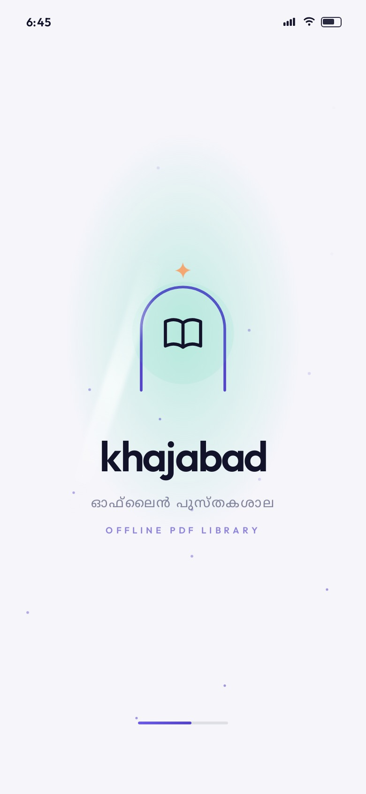
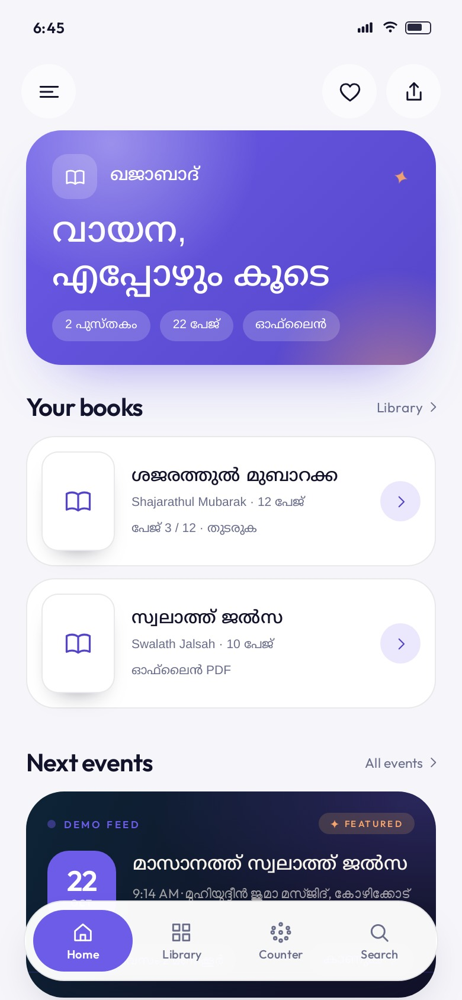
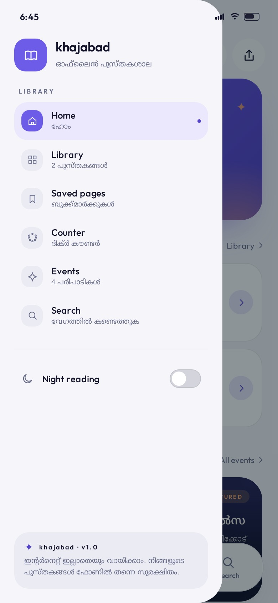
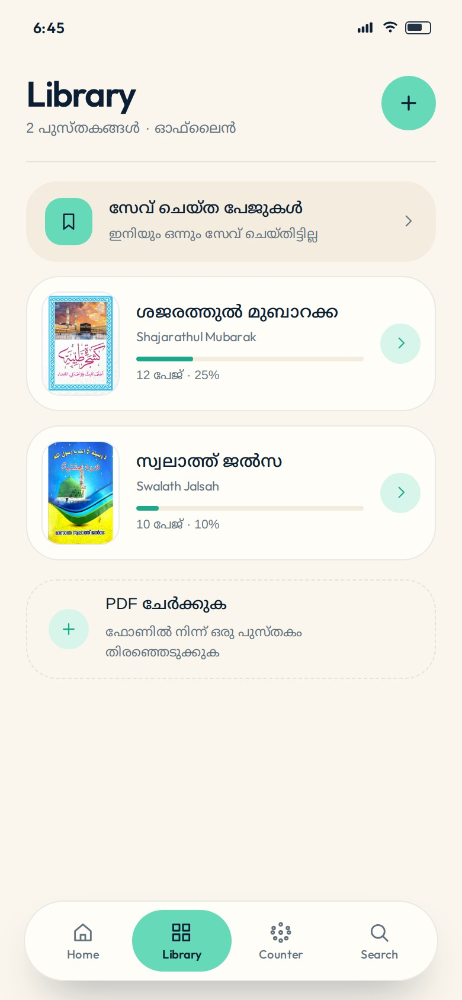
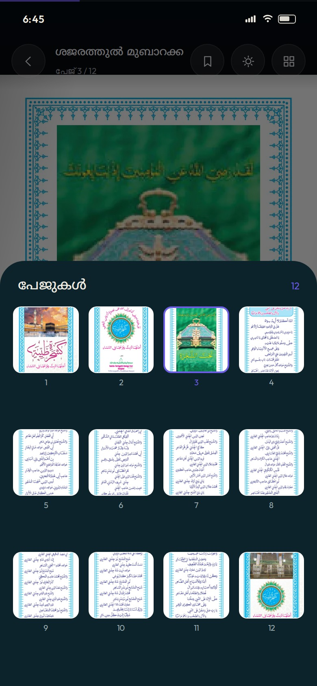
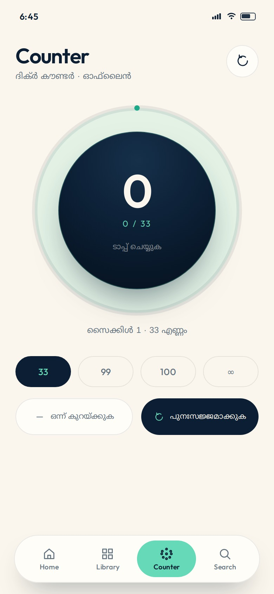
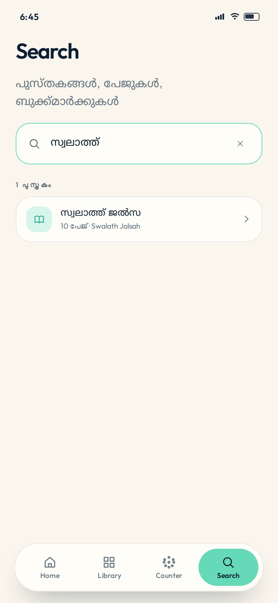
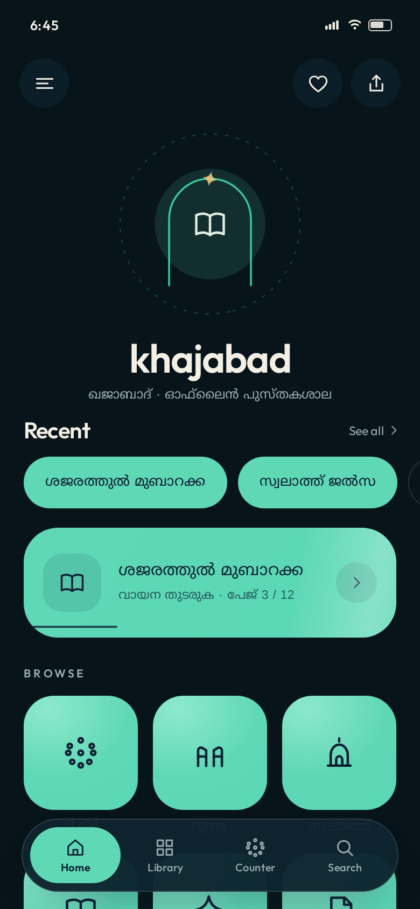

# khajabad · ഖജാബാദ്

A modern, offline PDF reader for Malayalam devotional books — built with **Kotlin + Jetpack Compose** and **no Material theme or Material components**. Cream paper, mint surfaces, deep‑ink typography, and motion that settles like water.

<p align="center">
  
  
  
  
</p>

---

## Screens

<p align="center">
  
  
  
</p>
<p align="center">
  
  
  
</p>
<p align="center">
  
  
  
</p>

---

## Look at it first

`preview/index.html` is a **fully interactive prototype** of the app (same palette, type, motion and the real book pages). Open it in a browser — no build step needed:

```bash
cd preview && python3 -m http.server 8080
# → http://localhost:8080
```

Tap the phone: open the drawer, swipe the reader page, tap the counter, search a book.

---

## What's inside

Two books are bundled and open instantly, offline:

| Book | Malayalam title | Pages | Source |
|---|---|---|---|
| `shajarath` | ശജരത്തുൽ മുബാറക്ക | 12 | `app/src/main/assets/books/shajarath.pdf` |
| `swalath_jalsah` | സ്വലാത്ത് ജൽസ | 10 | `app/src/main/assets/books/swalath_jalsah.pdf` |

You can also import any PDF from the device — it is copied into app storage and appears in the library.

### Screens

- **Splash** — a mihrab arch draws itself, the wordmark arrives letter‑by‑letter in discrete *stop‑motion* hops, a mint sheen sweeps across, then the home screen scales in.
- **Home** — hamburger / saved‑pages / share header, breathing arch mark with a dashed orbit, recent chips, featured "continue reading" card with a live progress hairline and slow sheen, and the 3 × 3 category grid (ദിക്ർ, ദുആ, സ്വലാത്ത്, മൗലിദ്, ബൈത്തുകൾ, മാലപ്പാട്ട്, രാത്തീബ്, മജ്ലിസുന്നൂർ, മറ്റുള്ളവ).
- **Library** — cover thumbnails rendered from page 1, per‑book progress, saved pages shortcut, import card.
- **Reader** — full‑bleed page, 3D page‑turn (`rotationY` + camera distance driven by pager offset), auto‑hiding chrome, scrubber, thumbnail sheet, bookmarking, night/day page, double‑tap zoom + pan.
- **Counter** — digital tasbih: a deep‑ink tap surface, mint progress ring, expanding ripples, haptics, presets 33 / 99 / 100 / ∞, undo and reset. Values persist.
- **Search** — searches titles, jumps to page numbers, lists saved pages.
- **Saved pages** and a **drawer** with night mode.

---

## Design system

Everything is defined in code — `ui/theme/Theme.kt` and `ui/theme/KhIcons.kt`.

| Token | Light | Dark |
|---|---|---|
| paper | `#FBF6ED` | `#07151A` |
| card | `#FFFDF8` | `#0E2530` |
| ink | `#0B1E33` | `#F3EFE5` |
| mint | `#65D9B8` | `#5FD8B6` |
| mint deep | `#1BA98A` | `#3AD6AE` |
| gold | `#E5B364` | `#EAC57D` |

- **Type** — Outfit (Latin) + Noto Sans Malayalam, subset and bundled as static weights in `res/font` (no Google Fonts dependency at runtime).
- **Icons** — every glyph is a hand‑built `ImageVector` path (menu, dome, mihrab, lantern, beads, hands, scroll, star). No icon font, no Material icons.
- **Shapes** — 28 dp tiles, 32 dp cards, 100 dp pills.
- **Motion** — `Motion.fluid()` (soft settle), `Motion.gentle()`, `Motion.snappy()`, and `Motion.stopMotion()` — a keyframes spec that *hops* through poses instead of gliding. Used by the splash letters, the counter and section reveals.
- **Components** — custom pill buttons, circular icon buttons, floating tab bar with a sliding mint indicator, custom switch, custom text field, ripples, shimmer placeholders. `androidx.compose.material*` is not a dependency at all.

---

## Architecture

```
app/src/main/java/com/khajabad/app/
├─ MainActivity.kt            edge-to-edge host
├─ KhajabadViewModel.kt       routes, books, counter, theme, import
├─ core/
│  ├─ Books.kt                Book + category catalogue
│  └─ PdfPages.kt             PdfRenderer rasteriser (single thread, byte-budgeted cache)
├─ data/
│  └─ KhajabadRepository.kt   Preferences DataStore: progress, bookmarks, counter, imports
└─ ui/
   ├─ KhajabadApp.kt          route graph + transitions + overlay chrome
   ├─ Route.kt
   ├─ theme/                  colours, type, motion, code-drawn icons
   ├─ components/             shared atoms (buttons, chips, PDF page, tab bar, toast)
   ├─ splash/ home/ library/ reader/ counter/ search/ bookmarks/ drawer/
```

- **Rendering** — pages are rasterised with the platform `android.graphics.pdf.PdfRenderer` at the size actually needed (thumbnail ↔ full screen), cached by byte budget, prefetched one page either side, and drawn with Compose `Image`.
- **Persistence** — Preferences DataStore only; no database, no network permission, no analytics.

---

## Build

Requirements: **JDK 17**, Android SDK **35**, Android Studio Koala or newer.

```bash
git clone <this repo> khajabad
cd khajabad
./gradlew assembleDebug          # app/build/outputs/apk/debug/app-debug.apk
./gradlew installDebug           # with a device/emulator attached
```

A ready GitHub Actions workflow (`.github/workflows/android.yml`) builds the debug APK on every push and uploads it as an artifact — the current build passes:

- **APK:** open the [Actions → Android CI](https://github.com/kuttappu507/khajabad/actions/workflows/android.yml) run and download `khajabad-debug-apk`
- Screenshots in this README are generated automatically from `preview/` by `.github/workflows/screenshots.yml`.

### Adding your own PDFs

1. Drop the file into `app/src/main/assets/books/`.
2. Register it in `core/Books.kt` (`Catalog`) with its page count and category — everything else (covers, reader, progress) is automatic.

Or just tap **PDF ചേർക്കുക** in the library at runtime.

---

## Notes & limits

- The reader rasterises pages, so text selection/copy inside a page isn't available (fine for calligraphy-heavy devotional books). Everything else — bookmarks, progress, thumbnails — is app-level.
- `minSdk 24`; night mode and the app's own palette are independent of the system.
- The Android sources were written in an environment without an Android SDK, so they have not been compiled here — run `./gradlew assembleDebug` (or the bundled CI workflow) to produce the APK. The interactive `preview/` prototype is self-contained and needs no build.

## Ideas for v1.1

- Page‑curl that follows the finger with a real mesh
- Audio recitation per page, timed to the text
- Widget for the daily dhikr counter
- Sharing a single page as an image card
